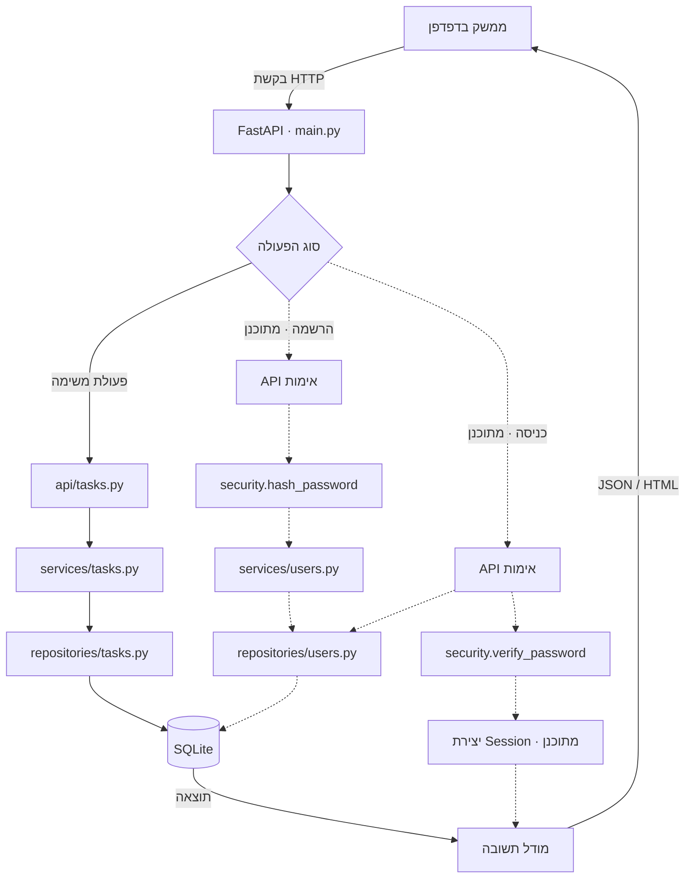

# הבית המסודר — גרסת Python ללמידה

זהו פרויקט מקומי ונפרד מהאתר החי. הוא כולל:

- שרת FastAPI עם תיעוד אוטומטי
- מסד נתונים SQLite מקומי
- יצירה, הצגה, עריכה, השלמה ומחיקה של משימות
- ממשק עברי פשוט שאפשר להרחיב
- הגדרת Debug מוכנה ל-VS Code

## הפעלה ראשונה ב-Windows

פתחו Terminal בתוך תיקיית הפרויקט והריצו:

```powershell
py -m venv .venv
.\.venv\Scripts\Activate.ps1
python -m pip install -r requirements.txt
python -m uvicorn app.main:app --reload
```

פתחו בדפדפן:

- האפליקציה: http://127.0.0.1:8000
- תיעוד ה-API: http://127.0.0.1:8000/docs

אפשר גם ללחוץ F5 ב-VS Code לאחר התקנת החבילות.

## מבנה הפרויקט

```text
bayit-mesudar-python/
├── app/
│   ├── api/
│   │   └── tasks.py          # endpoints של משימות
│   ├── repositories/
│   │   ├── tasks.py          # שאילתות משימות
│   │   └── users.py          # שאילתות משתמשים
│   ├── services/
│   │   ├── tasks.py          # כללים עסקיים של משימות
│   │   └── users.py          # כללים עסקיים של משתמשים
│   ├── database.py           # חיבור SQLite ויצירת הטבלאות
│   ├── main.py               # הרכבת אפליקציית FastAPI
│   ├── schemas.py            # מודלי קלט ופלט של Pydantic
│   └── security.py           # גיבוב ואימות סיסמאות
├── data/
│   └── .gitkeep              # מיקום מסד הנתונים המקומי
├── docs/
│   ├── DATA_MODEL.md         # מודל הנתונים והחלטות API
│   └── ROADMAP.md            # מפת הפיתוח
├── static/
│   ├── app.js                # לוגיקת הממשק בדפדפן
│   ├── index.html            # עמוד האפליקציה
│   └── styles.css            # עיצוב ו־RTL
├── tests/
│   ├── conftest.py           # fixtures ומסד בדיקות מבודד
│   ├── test_api.py           # בדיקות API של משימות ובריאות
│   ├── test_security.py      # בדיקות גיבוב ואימות סיסמאות
│   └── test_users.py         # בדיקות שכבות המשתמשים
├── README.md
└── requirements.txt
```

## זרימת הפעולות



חץ רציף מייצג זרימה שכבר מחוברת לאפליקציה; חץ מקווקו מייצג רכיב שתוכנן או נבנה חלקית ועדיין אינו חשוף כזרימת API מלאה.

### כלל תחזוקת התרשימים

- בכל הוספה, הסרה או העברה של תיקייה או קובץ מרכזי, יש לעדכן את עץ הפרויקט באותו שינוי.
- בכל שינוי במסלול בקשה, באחריות שכבה או בזרימת הרשמה, כניסה ו־Session, יש לעדכן את תרשים הזרימה באותו שינוי.
- סקירת שני התרשימים היא חלק מהגדרת הסיום של כל משימה ו־Pull Request.

## מה מפתחים עכשיו

שלב 2 הושלם, כולל עריכת משימה בממשק. כעת נבנית תשתית המשתמשים: טבלת `users`, ולידציה ושכבות נתונים בטוחות. הרשמה, התחברות ושיוך משימות יתווספו במשימות הבאות; אין עדיין endpoint ציבורי למשתמשים.

לסדר העבודה המלא: [docs/ROADMAP.md](docs/ROADMAP.md)

> חשוב: הנתונים מהאתר החי לא הועתקו לגרסה הזו. היא מתחילה עם נתוני דוגמה מקומיים כדי שתוכל ללמוד ולשנות בבטחה.
