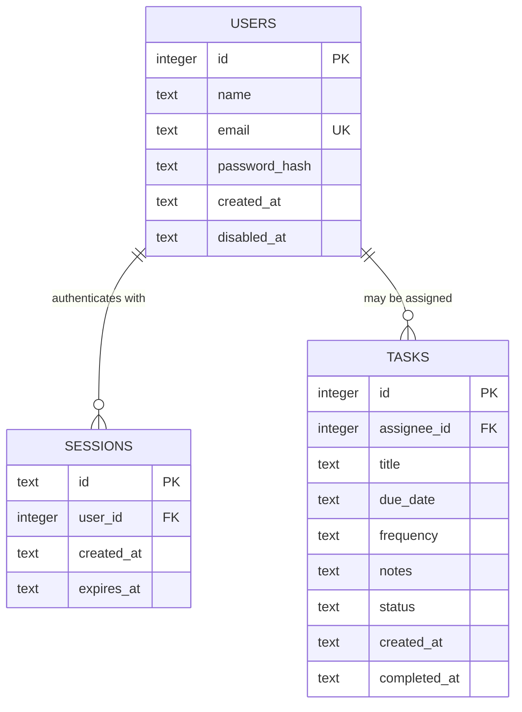

# מודל משתמשים ושיוך משימות — מרחב משותף יחיד

## מטרת המסמך

המסמך מגדיר את המודל הנוכחי להרשמה, התחברות ושיוך משימות למשתמשים. הוא מחליף את תכנון ריבוי הבתים שנדחה.

בשלב זה האפליקציה היא מרחב עבודה משותף אחד. כל משתמש רשום ומחובר רואה את אותן משימות ויכול לנהל אותן. שיוך משימה למשתמש מסמן אחריות לביצוע בלבד.

## מחוץ להיקף

- מספר בתים או מרחבי עבודה.
- `households`, `memberships`, הזמנות ותפקידי `owner`/`member`.
- הרשאות שונות בין משתמשים רשומים.
- איפוס סיסמה, אימות דוא״ל וכניסה באמצעות ספק חיצוני.
- מחיקה עצמית של חשבון.

## תרשים קשרים

## טבלת `users`

| שדה | סוג | חובה | אילוץ | משמעות |
|---|---|---:|---|---|
| `id` | `INTEGER` | כן | `PRIMARY KEY AUTOINCREMENT` | מזהה פנימי |
| `name` | `TEXT` | כן | אורך לאחר trim: ‏1–80 | שם תצוגה |
| `email` | `TEXT COLLATE NOCASE` | כן | `UNIQUE`, דוא״ל תקין | מזהה הכניסה |
| `password_hash` | `TEXT` | כן | לעולם לא מוחזר ב־API | hash סיסמה |
| `created_at` | `TEXT` | כן | `DEFAULT CURRENT_TIMESTAMP` | זמן יצירה ב־UTC |
| `disabled_at` | `TEXT` | לא | `NULL` כברירת מחדל | השבתה עתידית ללא מחיקה |

כללים:

- שם ודוא״ל מנורמלים באמצעות `strip()`; הדוא״ל נשמר באותיות קטנות.
- לא ניתן לרשום פעמיים אותו דוא״ל, גם בשינוי אותיות גדולות/קטנות.
- הסיסמה הגולמית קיימת רק בזמן הבקשה ואינה נשמרת או נכתבת ללוג.
- תשובת משתמש כוללת `id`, `name`, `email`, `created_at`; לעולם לא `password_hash`.

## טבלת `sessions`

| שדה | סוג | חובה | אילוץ | משמעות |
|---|---|---:|---|---|
| `id` | `TEXT` | כן | `PRIMARY KEY` | token אקראי וחזק |
| `user_id` | `INTEGER` | כן | `FK → users.id ON DELETE CASCADE` | בעל ה־Session |
| `created_at` | `TEXT` | כן | זמן UTC | זמן יצירה |
| `expires_at` | `TEXT` | כן | זמן UTC | תפוגה מוחלטת |

ה־Session נשלח בעוגייה עם `HttpOnly`, ‏`SameSite=Lax` ו־`Path=/`. בסביבת production העוגייה חייבת להיות גם `Secure`. התנתקות מוחקת את הרשומה ואת העוגייה. Token לא נכתב ללוג.

## שינוי טבלת `tasks`

השדה הטקסטואלי הקיים `assignee` יוחלף בהדרגה:

| שדה | סוג | חובה | ברירת מחדל | אילוץ |
|---|---|---:|---|---|
| `assignee_id` | `INTEGER` | לא | `NULL` | `FK → users.id ON DELETE SET NULL` |

החלטות:

- `NULL` פירושו “ללא אחראי”.
- ניתן להקצות משימה רק למזהה משתמש קיים.
- כל משתמש מחובר יכול להקצות או לבטל שיוך של כל משימה.
- מחיקה או השבתה עתידית של משתמש לא תמחק משימות. השיוך יבוטל או יוצג כלא פעיל לפי החלטת המימוש.
- תגובת משימה תכלול `assignee_id` ופרטי תצוגה מינימליים של האחראי, כדי שהממשק לא יצטרך לנחש שם לפי טקסט חופשי.

## API מתוכנן

### אימות

- `POST /api/auth/register` — יצירת משתמש והתחלת Session; מחזיר `201`.
- `POST /api/auth/login` — אימות דוא״ל וסיסמה והתחלת Session; מחזיר `200`.
- `POST /api/auth/logout` — ביטול Session; הפעולה idempotent.
- `GET /api/auth/me` — המשתמש המחובר; ללא Session מחזיר `401`.

### משתמשים

- `GET /api/users` — רשימת משתמשים פעילים לבחירת אחראי; דורש התחברות.
- אין endpoint ציבורי שמחזיר `password_hash` או פרטי Session.

### משימות

- פעולות `/api/tasks` דורשות משתמש מחובר.
- יצירה ועדכון מקבלים `assignee_id: int | null`.
- מזהה אחראי שאינו קיים מחזיר שגיאת `422` עם הודעה ברורה.

## מדיניות שגיאות ואבטחה

- הרשמה עם דוא״ל קיים מחזירה `409` ללא חשיפת מידע פנימי.
- כניסה עם דוא״ל לא קיים או סיסמה שגויה מחזירה אותה תשובת `401`.
- בקשה מוגנת ללא Session תקף מחזירה `401`.
- קלט לא תקין מחזיר `422`.
- אין להחזיר stack trace, hash, סיסמה או token.
- מסד הבדיקות זמני ומבודד ממסד הפיתוח.

## מעבר מהנתונים הקיימים

1. ליצור `users` ו־`sessions` בלי לשנות עדיין משימות.
2. להפעיל הרשמה והתחברות.
3. להוסיף `assignee_id` כ־nullable.
4. להחליט במפורש אם ליצור משתמשים מערכי `assignee` הישנים; אין ליצור חשבונות התחברות אוטומטית ללא כתובת דוא״ל וסיסמה.
5. במהלך מעבר זמני ניתן להחזיר גם את השם הישן לצורכי תאימות.
6. להסיר את `assignee` הטקסטואלי רק לאחר שהממשק והנתונים עברו ל־`assignee_id`.

## תרחישי קבלה מקצה לקצה

1. משתמש נרשם, מקבל Session ורואה את זהותו ב־`/api/auth/me`.
2. משתמש נוסף נרשם ומופיע ברשימת האחראים.
3. משתמש מחובר יוצר משימה ללא אחראי ואז משייך אותה למשתמש השני.
4. השיוך נשמר ומוצג לאחר טעינה מחדש.
5. ניתן לבטל את השיוך בלי למחוק את המשימה.
6. משתמש לא מחובר אינו יכול לקרוא או לשנות משימות.
7. דוא״ל כפול, סיסמה שגויה ומזהה אחראי לא קיים מטופלים ללא דליפת מידע.

## החלטות שנדחו

אם יעלה צורך אמיתי במספר בתים, יתווספו בעתיד `households` ו־`memberships` במיגרציה נפרדת. אין להוסיף אותם מראש או להכניס `household_id` ל־API הנוכחי.
