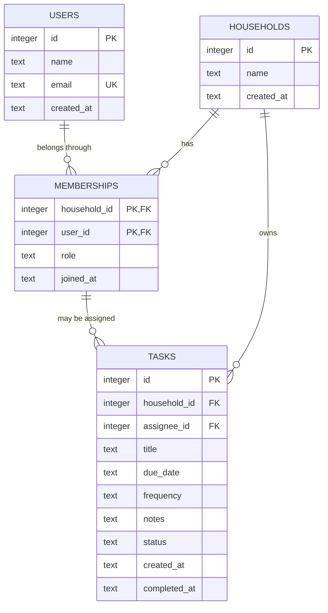

# מודל הנתונים לבתים ולמשתמשים

## מטרת המסמך

כיום כל המשימות נשמרות ברשימה אחת, והשדה `assignee` הוא טקסט חופשי. המודל הבא נועד לאפשר מספר בתים נפרדים, משתמשים שיכולים להשתייך ליותר מבית אחד, תפקיד שונה בכל בית, ומשימות שניתן להקצות רק לחבר בבית שאליו הן שייכות.

זהו מסמך תכנון בלבד. הטבלאות, ההגירות, ה־API וההרשאות עדיין אינם ממומשים.

## החלטות מרכזיות

- משתמש יכול להשתייך למספר בתים.
- בבית יכולים להיות מספר `owner`-ים, אבל חייב להישאר בו לפחות `owner` אחד.
- תפקיד המשתמש שייך לחברות בבית, ולא למשתמש עצמו. לכן אותו משתמש יכול להיות `owner` בבית אחד ו־`member` בבית אחר.
- כתובת דוא״ל מזהה משתמש באופן ייחודי, ללא תלות באותיות גדולות וקטנות.
- כל משימה חייבת להשתייך לבית אחד.
- משימה יכולה להישאר ללא אחראי.
- אחראי על משימה חייב להיות חבר פעיל באותו בית.
- אותו משתמש לא יכול להצטרף לאותו בית יותר מפעם אחת.
- הסרת חבר שמוקצות לו משימות תידחה עד שהמשימות יוקצו מחדש או יישארו ללא אחראי.
- מחיקת משתמש או בית תהיה פעולה מפורשת בשכבת השירות ולא מחיקת שרשרת אוטומטית ושקטה.

## תרשים קשרים



הקשר בין משימה לאחראי הוא קשר מורכב: הצמד `(household_id, assignee_id)` חייב להתאים לצמד `(household_id, user_id)` קיים ב־`memberships`. כך אי אפשר להקצות משימה למשתמש שאינו חבר באותו בית.

## טבלת `households`

| שדה | סוג | חובה | ברירת מחדל | מפתח/אילוץ | משמעות |
|---|---|---:|---|---|---|
| `id` | `INTEGER` | כן | אוטומטי | `PRIMARY KEY` | מזהה הבית |
| `name` | `TEXT` | כן | — | `CHECK (length(trim(name)) BETWEEN 1 AND 100)` | שם שמוצג למשתמשים |
| `created_at` | `TEXT` | כן | `CURRENT_TIMESTAMP` | — | זמן היצירה ב־UTC |

שם הבית אינו ייחודי: משפחות שונות יכולות לבחור באותו שם.

## טבלת `users`

| שדה | סוג | חובה | ברירת מחדל | מפתח/אילוץ | משמעות |
|---|---|---:|---|---|---|
| `id` | `INTEGER` | כן | אוטומטי | `PRIMARY KEY` | מזהה המשתמש |
| `name` | `TEXT` | כן | — | `CHECK (length(trim(name)) BETWEEN 1 AND 80)` | השם שמוצג במערכת |
| `email` | `TEXT COLLATE NOCASE` | כן | — | `UNIQUE` | מזהה התחברות עתידי |
| `created_at` | `TEXT` | כן | `CURRENT_TIMESTAMP` | — | זמן היצירה ב־UTC |

בשלב המימוש תבוצע גם ולידציה של מבנה הדוא״ל ב־Pydantic. האילוץ `COLLATE NOCASE` מונע יצירת שני משתמשים כמו `User@example.com` ו־`user@example.com`.

## טבלת `memberships`

| שדה | סוג | חובה | ברירת מחדל | מפתח/אילוץ | משמעות |
|---|---|---:|---|---|---|
| `household_id` | `INTEGER` | כן | — | `PRIMARY KEY`, `FK → households.id` | הבית |
| `user_id` | `INTEGER` | כן | — | `PRIMARY KEY`, `FK → users.id` | המשתמש |
| `role` | `TEXT` | כן | `'member'` | `CHECK (role IN ('owner', 'member'))` | תפקיד המשתמש בבית |
| `joined_at` | `TEXT` | כן | `CURRENT_TIMESTAMP` | — | זמן ההצטרפות ב־UTC |

המפתח הראשי המורכב `(household_id, user_id)` מונע חברות כפולה של אותו משתמש באותו בית, וגם מאפשר ל־`tasks` לוודא שהאחראי שייך לבית.

### תפקידי החברות

| פעולה | `owner` | `member` |
|---|---:|---:|
| צפייה במשימות הבית | כן | כן |
| יצירה, עריכה והשלמת משימות | כן | כן |
| הזמנת חברים והסרתם | כן | לא |
| שינוי תפקיד של חבר | כן | לא |
| שינוי פרטי הבית | כן | לא |
| מחיקת הבית | כן | לא |

האכיפה תתווסף בעתיד בשכבת השירות ובכל endpoint רלוונטי. שינוי או הסרה של ה־`owner` האחרון יידחו במסגרת אותה טרנזקציה.

## שינויים מתוכננים בטבלת `tasks`

השדות הקיימים נשארים ללא שינוי, למעט החלפת `assignee` הטקסטואלי בקשרים הבאים:

| שדה | סוג | חובה | ברירת מחדל | מפתח/אילוץ | משמעות |
|---|---|---:|---|---|---|
| `household_id` | `INTEGER` | כן | — | `FK → households.id` | הבית שהמשימה שייכת אליו |
| `assignee_id` | `INTEGER` | לא | `NULL` | חלק מ־FK מורכב ל־`memberships` | המשתמש האחראי |

האילוצים המתוכננים:

```sql
FOREIGN KEY (household_id)
    REFERENCES households(id)
    ON DELETE RESTRICT,

FOREIGN KEY (household_id, assignee_id)
    REFERENCES memberships(household_id, user_id)
    ON DELETE RESTRICT
```

כאשר `assignee_id` הוא `NULL`, המשימה אינה מוקצית. כאשר יש אחראי, המפתח הזר המורכב מבטיח שהוא חבר בבית הנכון.

## כללי מוצר ואכיפה

### יצירת בית

יצירת בית ומשייכות `owner` ראשונה יתבצעו באותה טרנזקציה. בית ללא בעלים לא ייחשב מצב חוקי של המוצר.

### הקצאת משימה

שכבת השירות תבדוק שהחברות קיימת לפני השמירה ותציג שגיאה ברורה. המפתח הזר המורכב יהיה שכבת הגנה נוספת במסד הנתונים.

### הסרת חבר

אם קיימות משימות פעילות או היסטוריות שמוקצות לחבר, ההסרה תידחה. לפני ההסרה יש לבטל את ההקצאה או להעביר את המשימות לחבר אחר. כך לא מאבדים את משמעות ההיסטוריה בלי החלטה מפורשת.

### מחיקת משתמש

מחיקת משתמש תידחה כל עוד קיימות לו חברויות. תחילה יש להסיר אותו מכל בית לפי כללי הסרת חבר. בעתיד אפשר לשקול השבתה במקום מחיקה פיזית כדי לשמור היסטוריה.

### מחיקת בית

מחיקת בית תהיה פעולה מפורשת ל־`owner` בלבד. השירות יציג למשתמש מה עומד להימחק, וימחק משימות וחברויות בתוך טרנזקציה לפני מחיקת הבית. לא נשתמש ב־`ON DELETE CASCADE` בשלב הראשון, כדי שמחיקה מקרית לא תתפשט ללא לוגיקה עסקית ואישור מתאים.

## תרחישי הצלחה

1. משתמש יוצר את ״משפחת כהן״. המערכת יוצרת בית וחברות שבה המשתמש הוא `owner` באותה טרנזקציה.
2. משתמש נוסף מצטרף ל״משפחת כהן״ בתפקיד `member`.
3. אותו משתמש מצטרף גם לבית נוסף; החברות בכל בית נשמרת בנפרד.
4. נוצרת משימה עם `household_id` של ״משפחת כהן״ וללא אחראי.
5. המשימה מוקצית לחבר ב״משפחת כהן״, והצמד בית־משתמש תואם לרשומת `memberships`.
6. משימה ללא אחראי מוקצית מאוחר יותר בלי לשנות את הבית שאליו היא שייכת.

## תרחישי שגיאה

1. ניסיון לצרף שוב משתמש שכבר חבר בבית נדחה בגלל המפתח הראשי המורכב.
2. תפקיד שאינו `owner` או `member` נדחה באמצעות `CHECK`.
3. ניסיון ליצור משימה ללא `household_id` נדחה.
4. ניסיון להקצות משימה למשתמש שאינו חבר בבית נדחה בשירות ובמפתח הזר המורכב.
5. ניסיון להשתמש בדוא״ל שכבר קיים, גם באותיות שונות, נדחה.
6. ניסיון להסיר או להוריד בדרגה את ה־`owner` האחרון נדחה בשירות.
7. ניסיון להסיר חבר שעדיין אחראי על משימות נדחה עד להעברת המשימות או ביטול ההקצאה.

## מעבר מהמודל הקיים

המעבר יתוכנן במשימת מימוש נפרדת ובאמצעות migration. הסדר המוצע:

1. ליצור את `households`, `users` ו־`memberships`.
2. ליצור בית מקומי ראשוני ומשתמשים מתוך ערכי `assignee` הייחודיים הקיימים, לאחר ניקוי ואישור הנתונים.
3. להוסיף ל־`tasks` את `household_id` ואת `assignee_id` באופן זמני כ־nullable.
4. לשייך את כל המשימות לבית הראשוני ולמפות אחראים קיימים למשתמשים.
5. לבדוק שאין משימות ללא בית ושכל אחראי חבר בבית.
6. להפוך את `household_id` לחובה ולהוסיף את המפתחות הזרים.
7. להסיר את שדה הטקסט הישן `assignee` רק לאחר אימות המעבר.

אין לבצע את השלבים האלה במסגרת מסמך התכנון הנוכחי.

## שאלות פתוחות למשימות עתידיות

- האם משתמשים יימחקו פיזית או יסומנו כלא פעילים כדי לשמור היסטוריה?
- האם צריך תפקידים נוספים, למשל `admin` או `viewer`, לאחר שנלמד את צורכי המשתמשים?
- האם משימה שהושלמה צריכה לשמור צילום של שם האחראי גם אם המשתמש עוזב?
- האם בעל הבית יכול להגביל יצירה ועריכה של משימות ל־`owner` בלבד?
- כיצד יישלחו ויאומתו הזמנות הצטרפות לבית? הנושא שייך לשלב ההתחברות וההרשאות.

## תנאי סיום לתכנון

- לכל טבלה יש שדות, סוגים, מפתחות ואילוצים.
- הקשרים בין בתים, משתמשים, חברויות ומשימות מתועדים.
- תפקידי `owner` ו־`member` מוגדרים.
- מנגנון מניעת הקצאה מחוץ לבית מוגדר ברמת השירות והמסד.
- תרחישי הצלחה ושגיאה מתועדים.
- התנהגות מחיקה ומעבר מהמודל הקיים מתועדות.
- שאלות שלא שייכות לשלב הנוכחי מסומנות כפתוחות.
- לא בוצע שינוי במסד הנתונים, ב־API או בממשק.
